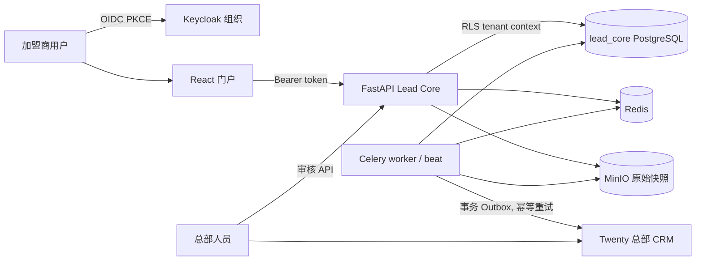

# 架构与信任边界

组织 ID 只取自已验证令牌中的 `org_id`，API 不接受客户端组织字段。加盟商详情查询先按 Claim 所属组织判断；数据库再通过 RLS 做第二层隔离。总部角色分为管理员、加盟运营、数据审核和审计员。

数据流从候选来源开始，必须经过来源审批、附件哈希去重、字段白名单、分类/去重与人工发布。领取前 DTO 不含地址、负责人或联系方式；领取成功后才返回字段证据。Twenty 故障只会积压 Outbox，不阻塞领取事务。

原始网页/附件快照在独立私有桶保存 30 天，定时删除对象但保留 `SourceDocument` 元数据和字段证据。审计、证据及评估记录的三年保留需要在生产归档策略中配置不可篡改备份。
